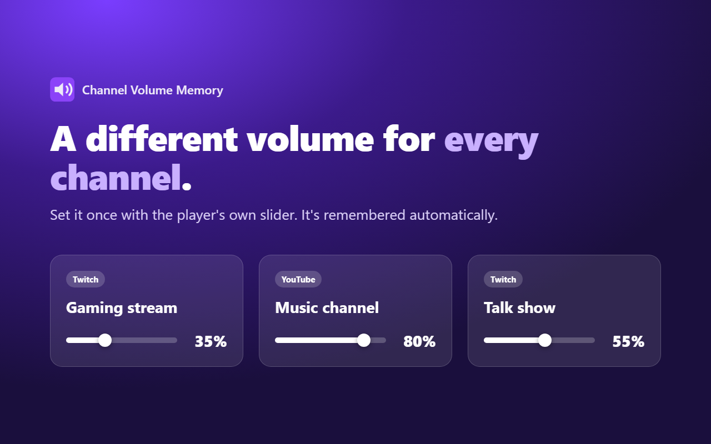
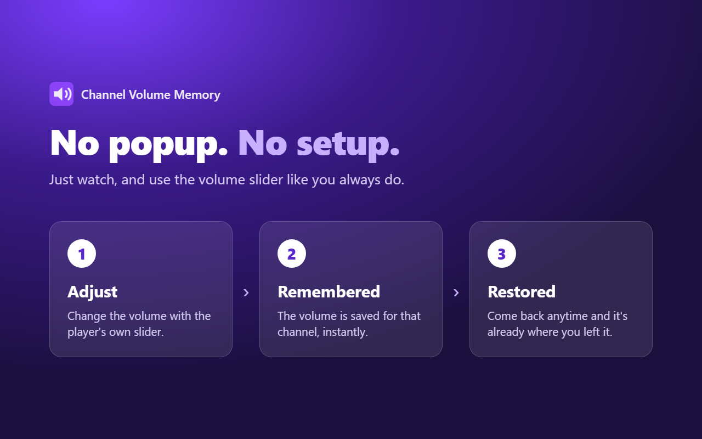
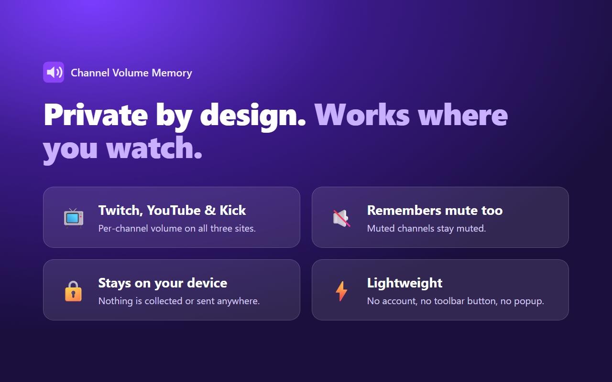

# Channel Volume Memory

Automatically remembers the player volume for each Twitch, YouTube and Kick channel. Use the site's own
volume slider as usual; the extension saves it per channel and restores it next time. No popup, no setup.

## Install (development)
1. Open `chrome://extensions` and enable **Developer mode**.
2. Click **Load unpacked** and select this folder.

## How it works
- Listens for volume/mute changes on the page's `<video>` element and stores them per channel in `chrome.storage.local`.
- Twitch: channel comes from the URL; the native volume slider is set on restore.
- Kick: channel comes from the URL; the volume is set on the video element directly.
- YouTube: channel comes from the watch page's channel link (`@handle`); applies on `/watch` pages.
- Volume changes shortly after a channel loads are ignored so the site's own startup reset isn't recorded.

## Adding a site
Add an adapter in `content.js` (`getChannel()` and `setVolume()`) and a match pattern in `manifest.json`.

## Privacy
Everything stays on your device. See [PRIVACY.md](PRIVACY.md).

## Install from a release
Download `channel-volume-memory.zip` from the [Releases](../../releases) page, unzip it, then use **Load unpacked** as above.

## Packaging
Run `./build.sh` to produce `dist/channel-volume-memory.zip` for the Chrome Web Store.
